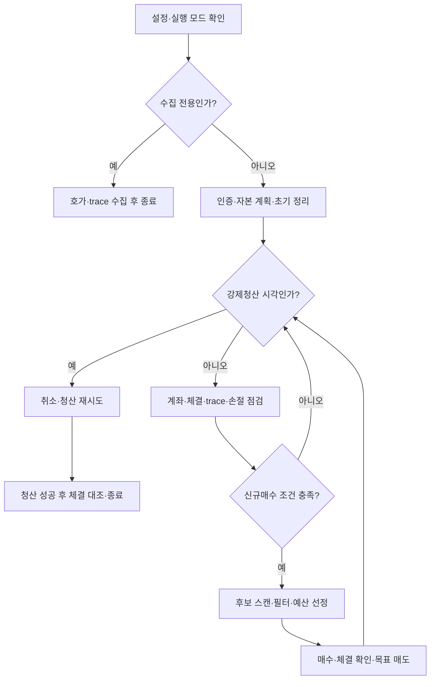

# 데일리봇 현재 동작 과정

확인일: **2026-11-20**. 코드 기준: main의 [`94e3cd5f923178f16b42d59796ca3069dac952f4`](https://github.com/FoggyCaligo/StockAutoTradingBot/tree/94e3cd5f923178f16b42d59796ca3069dac952f4).

이 문서는 저장소 코드와 기본 설정을 대조한 운영 설명이다. 실제 운영 PC의 실행 여부, 계좌 상태, `.env` 내용이나 Windows 작업 스케줄러 설정을 확인한 기록은 아니다. 이후 코드가 바뀌면 이 문서의 확인일과 기준 SHA도 갱신한다.

**현재 유지하는 정책:** 최초 진입 0.71%, 익절 슬롯 재진입 0.90%, 호가 가중치 1.0→0.0, 신규매수 09:30~11:30, 강제청산 15:15. 동적 손절 후 전체 신규매수 차단과 손절 슬롯 당일 폐쇄도 유지한다. 10:30 매수 종료·가중치 하한 0.3·빈 슬롯 완전 해제 실험은 운영 설정에 반영하지 않았다.

## 1. 실행 모드와 진입점

저장소 루트에서 실행하는 예시다. 아래는 실행 방법 설명이며, 문서 작성 과정에서 봇을 실행하거나 주문하지 않았다.

| 실행 방법 | 실제 분기 |
|---|---|
| `./Daily_bot/scripts/run_real.ps1` | `session_slot_runner.py --real --enable-trading`. 해당 프로세스의 실제 주문을 명시적으로 허용한다. `.env`의 `is_real_trade=false`보다 이 옵션이 우선한다. |
| `./Daily_bot/scripts/run_real.ps1 -CollectOnly` | 별도 수집기로 실행. 환경변수가 true여도 주문 권한을 false로 설정한다. |
| `python Daily_bot/session_slot_runner.py --real` | 키움 REST 클라이언트 사용. 주문 허용은 `is_real_trade` 환경변수를 따르며, false이면 수집 전용으로 전환한다. |
| `python Daily_bot/session_slot_runner.py --real --enable-trading` | 세션 슬롯 정책을 설치하고 실제 주문을 허용한다. |
| `python Daily_bot/session_slot_runner.py --dry-run` | 실제 주문을 보내지 않는 모의 브로커 매매 루프다. 실시간 키움 시세 수집 전용 모드와 다르다. |

- 기본 설정은 [settings.yaml](../config/settings.yaml)이고 `--config`로 다른 파일을 지정할 수 있다. CLI 모드 지정이 없으면 `risk.dry_run`을 따른다. 기본값은 false다.
- 키·계좌·서버 설정은 환경변수와 `python-dotenv`가 읽는 `.env`를 사용한다. 일반 배치는 `Daily_bot/.env`이며 기존 프로세스 환경변수가 우선한다. 키나 비밀값은 문서에 적지 않는다.
- `--dry-run`과 `--real`은 함께 사용할 수 없고 `--enable-trading`은 `--real`이 있어야 한다.
- `main.py` 직접 실행은 `session_slot_runner.py`의 슬롯 폐쇄·익절 재진입 임계값 설치를 거치지 않는다. 권장 진입점과 동등한 실행으로 취급하지 않는다.
- PowerShell 스크립트는 저장소의 `.venv/Scripts/python.exe`를 사용하고 작업 디렉터리를 `Daily_bot`으로 맞춘다. 매매 러너·수집기 프로세스와 lock을 확인하여 중복 실행을 줄인다. 직접 실행에서는 상대 유니버스 경로가 작업 디렉터리에 따라 달라질 수 있다.
- `--dry-run`도 기본 DB·로그 경로를 자동으로 별도 분리하지 않는다. 모의 기록과 실거래 기록을 구분해야 한다.

근거: [run_real.ps1](../scripts/run_real.ps1), [session_slot_runner.py](../session_slot_runner.py), [main.py](../main.py)의 `parse_args`, `build_client`, `run`.

## 2. 시간표와 종료 조건

시각은 코드의 `datetime.now()`가 사용하는 **운영 PC 로컬 시각**이다. 한국 장 운영에는 PC의 시간대와 시계가 맞아야 한다. 봇이 매일 스스로 다시 켜지는 구조는 아니며, 반복 실행 일정은 외부 실행 설정이 담당한다. 이 루프 자체에서 거래소 휴장일을 판별하지 않는다.

| 설정 | 값 | 실제 의미 |
|---|---|---|
| `prewarm_start_time` | 08:55 | 09:30까지 종목 목록·전일 기준가·세션 자본과 슬롯 계획 준비를 시도한다. |
| `startup_clear_time` | 09:10 | 이 시각 이후 첫 초기 정리에서 계좌 미체결과 기존 보유 종목을 정리한다. 늦게 켜면 정리도 늦게 수행한다. |
| `start_buy_time` | 09:30 | 신규매수 판단 시작. 초기 정리가 끝나야 진입한다. |
| `stop_buy_time` | 11:30 | 신규매수 판단 종료. 보유·미체결 관리와 손절은 계속한다. |
| `force_sell_time` | 15:15 | 미체결 주문 취소 확인 후 잔여 보유 종목 시장가 청산을 시도한다. |
| `reconcile_time` | 15:20 | 강제청산 성공 후 브로커 체결과 로컬 기록을 대조한다. **성공하면 이 시점 이후 바로 종료할 수 있다.** |
| `end_time` | 15:25 | 대조가 실패하는 경우 종료 판단에 쓰는 시각이다. 강제청산 자체가 실패하면 계속 재시도하므로 이 시각까지 종료가 보장되지는 않는다. |

시각 판단은 분 단위이고 양 끝을 포함한다. 11:30분의 루프도 매수 가능으로 판단될 수 있다. 또한 매수 시간은 루프 시작 때 계산하므로 진행 중인 전체 스캔·주문·체결 대기를 11:30에 강제로 중단하지 않는다. 15:15 역시 비동기 타이머가 아니라 다음 루프에서 확인하는 조건이다.

## 3. 하루 흐름 요약

1. 설정과 실행 모드를 읽고, 주문 허용 여부에 따라 매매 루프 또는 수집기로 분기한다.
2. 매매 루프는 DB·로그를 준비하고 인증한다. 인증 실패 시 5초 대기 후 재시도한다.
3. 시작 계좌가치를 추정하고 코스피 지수 등락률을 기록용으로 조회한다.
4. 08:55 이후 워밍업을 시도하고 세션 자본·슬롯 수·슬롯당 예산을 계산한다.
5. 09:10 이후 기존 미체결 주문을 취소하고 보유 종목을 정리한다. 완료 전에는 신규매수를 하지 않는다.
6. 09:30 이후에는 매 루프마다 계좌 상태·새 체결·관심 종목·보유 종목을 먼저 확인하고 동적 손절 및 일손실 조건을 점검한다.
7. 매수 시간·슬롯·계좌 조회 조건을 통과하면 종목 전체 스캔, 호가 예상가 계산, 기대수익률 정렬과 진입 필터를 수행한다.
8. 빈 슬롯과 현금 범위에서 최대 3종목을 선택하고 종목별로 매수→체결 확인→목표 지정가 매도를 순차 처리한다.
9. 익절로 빈 슬롯은 조건을 만족하면 재사용한다. 동적 손절이 발생하면 현재 실행의 전체 신규매수도 중단한다.
10. 15:15 이후 취소·청산을 재시도하고, 청산 성공 후 15:20 이후 체결 대조와 종료를 처리한다.



초기 정리는 봇이 과거에 산 종목만 선별하는 로직이 아니다. 브로커가 반환한 계좌 보유·미체결을 대상으로 하므로 수동 매수 보유분도 포함될 수 있다. 정리가 실패하면 신규매수는 계속 차단하고, 조회 가능한 보유 종목의 trace를 기록한다.

## 4. 후보 선정과 기대수익률

| 단계 | 현재 값·판정 |
|---|---|
| 시장 범위 | KOSPI + KOSDAQ. 코스피 지수 하락을 이유로 일괄 매수를 차단하는 별도 필터는 없다. |
| 목록 갱신 | FinanceDataReader 목록을 일별 갱신하고 `data/krx_latest.csv` 캐시를 사용한다. 갱신 실패 시 사용 가능한 로컬 CSV·캐시로 대체한다. |
| 시가총액 | 250,000,000,000원, 즉 **2,500억원 이상** |
| 거래대금 | 3,000,000,000원, 즉 **30억원 이상**. 거래량 수량 필터가 아니며 목록·캐시의 값으로 판단한다. |
| 호가 | 정상 실서버 응답에서는 매수 10단계 + 매도 10단계를 파싱한다. 파싱 실패 종목은 건너뛴다. |
| 잔량 가중치 | 매수·매도 각각 가까운 호가부터 **1.0→0.0 선형 감쇠**. 가장 먼 레벨의 잔량 가중치는 0이다. |
| 예상가 | 감쇠된 매수·매도 잔량을 상쇄한 경계 가격의 중간값을 호가 단위에 맞춘 `expect_price` |
| 목표가 | `expect_price`에서 `sell_tick_offset=1`틱을 뺀 뒤 호가 단위에 맞춘 가격 |
| 기대수익률 | `(목표가 − 현재가) / 현재가 × 100`. 수수료·세금 차감 전 가격 차이다. |
| 최초·미사용 슬롯 | 기대수익률 **0.71% 이상**, 목표가가 매수가보다 높아야 한다. |
| 정렬 | 기대수익률 **내림차순**. 높은 종목부터 검토한다. |
| 상위 비율 컷 | `top_ratio=1.0`으로 비활성. 상위 n%를 자르는 방식이 아니다. |
| 중복 제외 | 보유 또는 미체결 주문이 있는 종목과 현재 세션에서 손절 차단된 종목은 신규 진입 후보에서 제외한다. |

추세, 스프레드, 전일 등락률 상·하한, 직전 스캔 대비 급등, 매도호가 잔량 비율 필터는 현재 비활성이다. 기대수익률 fallback 목록도 비어 있어 기준을 자동 완화하지 않는다.

시총·거래대금 필터는 해당 컬럼이 있는 데이터에서 수행된다. 원본 목록에 필요한 컬럼이 없으면 필터 함수가 그대로 통과시키는 경로가 있으므로, 모든 수집 데이터에서 두 하한이 반드시 검증됐다고 단정하지 않는다.

근거: [universe.py](../strategy/universe.py)의 `get_candidates`, `filter_by_market_cap`, `filter_by_trading_value`; [signal.py](../strategy/signal.py); [orderbook_predictor.py](../strategy/orderbook_predictor.py).

## 5. 자본·슬롯·수량

세션 자본은 우선 브로커의 **주문가능금액**으로 잡고, 양수가 아니면 계좌가치 추정으로 대체한다. 워밍업 때 계산된 계획은 통상 당일 고정하며, 워밍업을 못 했으면 초기 정리 후 계획을 만든다. 워밍업이 초기 정리보다 먼저 성공하면 그때의 금액이 유지된다.

현재 양수 자본 C에 대한 계산은 다음과 같다.

```text
슬롯 수 = min(10, max(3, floor(C / 5,000,000)))
동시 보유·주문 종목 상한 = min(슬롯 수, 10)
슬롯당 계획 예산 = floor(C / 슬롯 수)
매수 수량 = floor(해당 종목에 배정된 예산 / 매수 지정가)
```

| 주문가능 세션 자본 가정 | 슬롯 수 | 슬롯당 계획 예산 |
|---|---:|---:|
| 200만원 | 3 | 약 666,666원 |
| 2,000만원 | 4 | 500만원 |
| 5,000만원 | 10 | 500만원 |
| 7,000만원 | 10 | 700만원 |

- 한 스캔의 신규매수는 최대 3종목이다. 전체 슬롯을 항상 한 번에 채우는 것은 아니다.
- 가격·수량·현금 조건에 따라 더 낮은 순위 종목을 선택하거나 매수 종목 수를 줄인다. 동일 예산이어도 주식 수량이 정수라 실제 매수금액은 같지 않을 수 있다.
- `max_budget_per_cycle_krw=0`, `max_budget_per_stock_krw=0`으로 별도 금액 하드캡은 없다. **200만원은 코드에 고정된 계좌 운용 상한이 아니다.**
- `target_budget_ratio_per_stock=0.50`도 설정에 있지만 현재는 500만원 단위 슬롯 계산 경로가 우선하여 단순히 종목당 자본 50%로 계산하지 않는다.
- 주문가능금액 파서는 증거금률별 주문가능금액 중 가장 큰 양수를 우선한다. 현금 예수금·자기자본과 같다고 볼 수 없고, 종목별 실제 주문 가능 수량을 새로 검증하는 기능과도 다르다.

근거: [main.py](../main.py)의 `resolve_session_capital_basis`, `resolve_total_slot_count`, `resolve_target_budget_per_stock`, `resolve_buy_count`; [guards.py](../risk/guards.py); [kiwoom_client.py](../broker/kiwoom_client.py)의 `_extract_orderable_cash`.

## 6. 매수와 목표 매도

1. 매수 직전에 보유·미체결을 다시 조회하여 종목 상한을 확인한다. 조회 실패 시 그 매수 처리를 멈춘다.
2. 후보의 스캔 현재가를 지정가로 하여 정수 수량 매수를 요청하고 주문을 기록한다.
3. 기본 최대 30초 동안 2초 간격으로 매수 체결을 확인한다. 요청 수량의 전량 체결을 기다리는 경로다.
4. 체결이 확인되면 체결을 기록하고, 그 수량에 대해 목표 지정가 매도주문을 제출한다.
5. 목표가는 보통 예상가−1틱이다. 실거래 `_safe_target_sell_price`는 계산값이 기준 매수가+1틱보다 낮으면 그 가격으로 올리는 보정도 수행한다. 따라서 모든 상황에서 처음 계산한 예상가−1틱이 그대로 주문되는 것은 아니다.
6. 제한시간 내 전량 체결이 확인되지 않으면 미체결 매수를 취소한다. 취소 후 부분체결 또는 실제 보유수량이 확인되면 그 수량에 대한 매도주문을 복구한다.
7. 이후 체결 조회에서는 이미 기록한 수량을 제외한 증가분을 기록하고, 추가 매수 체결분에 대한 매도주문 복구도 시도한다.

종목별 처리는 순차적이다. ‘체결 즉시 매도’는 체결을 API로 **확인한 뒤** 주문한다는 뜻이며 실시간 체결통보와 같은 지연 보장은 없다. 매수 오류 후에는 계좌를 다시 확인하고 해당 매수 배치를 중단한다.

근거: [main.py](../main.py)의 `activate_buy`, `submit_exit_order`, `poll_and_record_new_fills`, `submit_target_exit_order_from_position_if_present`; [kiwoom_client.py](../broker/kiwoom_client.py)의 `wait_buy_filled`.

## 7. 익절 슬롯 재사용과 손절

### 익절 후 재진입

`allow_refill_empty_slots=true`이고 전체 포지션이 비워질 때까지 기다리는 full-batch lock은 없다. 미사용 용량은 0.71%, 익절 반환 용량은 0.90% 기준으로 재사용한다. 실제 세션 러너는 개별 슬롯별 체결원인을 저장해 구분하기보다 **관측된 최대 활성 종목 수와 현재 활성 종목 수**로 미사용·반환 용량을 추정한다.

손절 슬롯 수를 뺀 유효 상한에서 미사용 용량이 남아 있으면 그 용량을 우선 사용한다. 미사용 용량이 없고 반환 용량이 있는 재진입 사이클에서 0.90% 기준을 적용한다. 이는 ‘언제나 새 종목 3개를 사고 전부 팔 때까지 기다린다’는 정책이 아니다.

### 동적 기대수익률 손절

환경변수 기본값은 다음과 같다.

| 항목 | 기본값 |
|---|---:|
| `DYNAMIC_EXPECT_STOP_PERCENT` | -0.1% |
| `DYNAMIC_EXPECT_STOP_CONSECUTIVE` | 3회 |

보유 종목의 새 호가로 목표가와 **현재가 대비 기대수익률**을 재계산한다. -0.1% 이하가 3회 연속이면 기존 종목 주문을 취소하고 취소 확인 후 실행 가능한 호가에 지정가 매도를 요청한다. 기준을 벗어나면 연속 횟수는 초기화한다. 이 기준은 매입가 대비 손실 -0.1%와 다르고, 3회는 고정 3초가 아니다.

손절 처리 성공을 반환하면 다음 동작이 이어진다.

- 해당 종목을 현재 매매 루프의 당일 재진입 차단 목록에 넣는다.
- 세션 슬롯 정책에서 해당 슬롯을 당일 폐쇄한다.
- **dynamic stop이면 현재 프로세스의 `market.stop_buy_time`을 `00:00`으로 바꿔 전체 신규매수도 중단한다.** 보유 종목 관리와 장마감 청산은 계속한다.

여기서 손절 처리 성공은 매도주문 제출 및 후처리 결과이며, 잔여 수량의 완전 체결을 항상 보장하는 표현은 아니다. 기본 고정 손절은 `stop_loss_percent=0`, `stop_loss_tick_count=0`, `stop_loss_tick_multiplier=0.0`으로 꺼져 있다. 동적 손절 기본값은 환경변수로 변경·비활성화할 수 있으므로 실제 PC 환경도 확인해야 한다.

### 일손실 제한

입출금 보정 후 시작 계좌가치 대비 손실이 **10% 이상**이면 신규매수를 차단한다. 보유 종목을 즉시 전량 청산하는 조건은 아니다. 이 판정은 루프에서 재계산하며 별도의 영구적인 일손실 중단 플래그는 아니다. 시작 계좌가치와 입출금 보정은 현재 코드의 추정 방식에 따른다.

근거: [session_slot_runner.py](../session_slot_runner.py)의 `DailySlotClosurePolicy`, `install_daily_slot_closure_policy`; [stop_loss.py](../risk/stop_loss.py)의 `monitor_stop_loss`; [main.py](../main.py)의 `is_daily_loss_limit_reached`.

## 8. 장마감 정리와 오류 처리

15:15 이후에는 신규 스캔보다 청산을 우선한다. `force_sell`은 다음 순서를 지킨다.

1. 계좌의 미체결 주문 취소.
2. 취소 완료 확인. 남아 있으면 중복 주문을 피하기 위해 청산을 실패로 반환한다.
3. 보유 종목 전량 시장가 매도 요청과 체결 기록 시도.
4. 보유가 사라졌는지 확인. 남아 있거나 오류가 나면 다음 루프에서 재시도한다.

청산 성공 이후 15:20부터 브로커 체결 대조를 시도한다. 성공하면 종료하고, 실패하면 기본 15:25까지 대조를 재시도하는 경로다. 청산에 실패한 상태를 15:25에 무조건 종료하는 코드는 아니다. 장마감 정리는 손익이 난 종목과 손실 중인 종목을 모두 대상으로 한다.

계좌 조회·손절 처리 실패 시에는 신규매수를 진행하지 않고 재조회·재시도한다. 호가 조회 실패는 해당 종목을 건너뛰는 경로가 있다. 네트워크 재시도와 전체 스캔 때문에 시간표의 시각에 즉시 주문된다고 보장하지 않는다.

근거: [force_sell.py](../risk/force_sell.py), [main.py](../main.py)의 `_attempt_force_sell_safely`, `_attempt_stop_loss_safely`, `run`.

## 9. market trace·체결·운영 로그

| 저장 대상 | 위치·내용 |
|---|---|
| SQLite | `Daily_bot/bot.sqlite3`. 호가·신호·주문·체결·시장 trace·계좌 추정·전일 기준가 등 |
| 시장 trace CSV | `Daily_bot/logs/market_traces_YYYYMMDD.csv`. 후보 스캔, 관심 종목 재조회, 보유 종목 관측과 원본 호가 응답 |
| 체결 CSV | `Daily_bot/logs/fills_YYYYMMDD.csv`. 실제 확인된 체결을 중심으로 저장하며 포지션 복구·추정 청산 체결 등 일부 추정 source는 CSV에서 제외 |
| 실행 로그 | `Daily_bot/logs/run_real_YYYYMMDD_HHMMSS.log`. PowerShell 스크립트가 프로세스 종료 후 표준출력·오류를 합친 파일 |
| 실행 중 출력 | 위 스크립트로 실행 중이면 같은 디렉터리의 `*.stdout.tmp`, `*.stderr.tmp`에도 확인 가능 |
| 세션 슬롯 상태 | `Daily_bot/logs/session_closed_slots.json`. 세션 날짜·폐쇄 종목·최대 활성 종목 수 |

실거래는 후보 전체 스캔 시 `scan_candidate`, 관심 종목 재조회 시 `watchlist`, 보유 종목 관측 시 `active_position` trace를 기록한다. 초기 청산이 지연되는 동안에도 조회 가능한 보유 종목은 기록한다. 그러나 매수 종료·슬롯 포화·계좌 오류·전체 중단 조건으로 **전체 후보 스캔은 실행되지 않을 수 있다.** 매매 프로세스가 살아 있다고 모든 종목 trace가 일정하게 쌓이는 것은 아니다.

시작 로그의 `Market trace output`에서 실제 DB·CSV 경로를 확인한다. `Market trace scan completed`의 `calculated`는 계산된 종목 수이며 저장 파일의 증가를 별도로 확인해야 한다. SQLite·CSV의 `Recorder ... sink disabled` 경고가 있으면 해당 저장 기능이 꺼진 상태일 수 있다. 실거래는 경고 후 계속되는 경로가 있지만, 수집 전용 모드는 DB/CSV 저장 실패를 감지하면 실패 종료한다.

별도 `orders_*.csv`, `account_traces_*.csv`, `daily_reference_prices_*.csv`, `daily_rev.csv`, 상세 audit CSV와 현금 debug 파일은 현재 실거래 CSV 출력 정책에서 제외돼 있다. 관련 메서드·SQLite 내부 상태·백테스트 출력의 존재와 구분한다. 운영 PC의 파일은 자동으로 GitHub에 업로드되지 않는다.

근거: [db.py](../storage/db.py), [trace_helpers.py](../telemetry/trace_helpers.py), [run_real.ps1](../scripts/run_real.ps1).

## 10. 수집 전용 모드와 API 간격

수집기는 계좌 포지션 정리·주문·취소·손절·체결 대조를 실행하지 않는다. 기본 **09:30~15:25**에 적격 종목의 호가와 기대수익률을 `scan_candidate`, `reason=quote_only_collection`로 기록한다. 목록은 정상 수집 중에는 세션 내 재사용하며, 목록 조회 실패·빈 목록·저장 0건이면 다음 주기에 재조회한다.

`market_trace_collection.start_time`, `end_time`, `interval_seconds`로 수집 시간을 따로 지정할 수 있다. 항목이 없으면 각각 매수 시작·장 종료·스캔 간격 설정을 사용한다. 반복 간격 60초는 **전체 수집이 끝난 뒤의 대기**이므로 반드시 모든 종목을 60초마다 관측한다는 뜻은 아니다.

현재 클라이언트 구현의 간격 제어는 다음과 같다.

- 기본 전체 요청은 주문·조회를 합쳐 최대 초당 5회. `KIWOOM_RATE_LIMIT_PER_SECOND`로 더 낮출 수 있고 5회 초과로 높일 수 없다.
- 잔고 조회 `kt00018`은 추가로 같은 TR 간 최소 1초를 둔다.
- 키움 모의 서버 `mockapi.kiwoom.com`은 TR별 최소 1초를 적용한다. 로컬 모의 브로커 `--dry-run`과는 다르다.
- 연속조회와 재시도도 동일 간격을 따르며, 개별 TR 대기와 전체 요청 간격을 함께 지킨다.
- 간격은 클라이언트 인스턴스 내부 제어다. 다른 프로세스·프로그램이 같은 계좌/토큰으로 보내는 요청까지 합산하지 않는다.

실거래의 `scan_interval_seconds=60`도 고정 주기 스케줄러가 아니다. 보유 중 관리 분기에는 기본 5초 대기가 있고, 분기마다 대기·호가 요청·체결 대기 시간이 추가된다.

근거: [market_trace_collector.py](../market_trace_collector.py), [kiwoom_client.py](../broker/kiwoom_client.py)의 `_request_response`, [utils.py](../utils.py)의 `RateLimiter`.

## 11. 재시작 시 유지·초기화되는 상태

| 상태 | 현재 동작 |
|---|---|
| 세션 슬롯 JSON | 같은 날짜이면 폐쇄 종목·최대 활성 종목 수를 복구한다. 다른 날짜의 내용은 읽지 않는다. |
| 전체 신규매수 중단용 `stop_buy_time=00:00` | 실행 중 설정 객체의 변경이다. 설정 파일에는 쓰지 않으므로 재시작하면 기본 파일을 다시 읽는다. |
| 매매 루프의 손절 종목 차단 set | 메모리 상태다. JSON의 폐쇄 종목이 이 set에 그대로 재주입되는 구조는 아니다. |
| 동적 손절 연속 관측 횟수 | 메모리 상태이며 새 프로세스에서 다시 시작한다. |
| 초기 보유 정리 | 새 프로세스도 09:10 이후 초기 정리 경로를 수행할 수 있다. 기존 보유에 다시 청산 주문이 발생할 수 있다. |

따라서 ‘손절 후 오늘은 중단했다’는 상태 전체가 재시작 후 똑같이 복구된다고 해석하지 않는다. 보통의 정상 종료 뒤 다음 거래일에는 새 프로세스로 새 세션을 준비한다.

## 12. 기존 백테스트와 실거래의 차이

선택한 기존 표준 러너는 [replay_refill_threshold.py](../backtest/replay_refill_threshold.py)다. 현재 전략 값과 슬롯·동적 손절·익절 재진입 기준을 비교하는 기준으로 사용한다. 이 러너가 실거래의 모든 제어 경로를 그대로 실행한다는 뜻은 아니다.

- 표준 러너는 [replay_dynamic_expect_debounce_reserve_stopped_slots.py](../backtest/replay_dynamic_expect_debounce_reserve_stopped_slots.py)를 통해 손절 슬롯 폐쇄와 재진입 제한을 모의한다.
- **실거래의 ‘동적 손절 후 당일 전체 신규매수 차단’은 이 표준 경로에 포함되지 않는다.** 이 차이를 보완한 별도 비교 결과와 기존 러너 그대로의 결과를 혼동하지 않는다.
- 재현 가능한 종목·시각은 저장된 trace 범위로 제한된다. 없는 호가·체결을 실제 관측으로 간주하지 않는다.
- 15:15 가격이 없으면 `force_exit_last_trace` 등 마지막 관측값 청산이 포함될 수 있다.
- 실거래의 목표가격 보정, 부분체결 복구, 주문 대기열·슬리피지·API 지연과 계좌 위험관리 전체가 완전히 동일하게 복제되지는 않는다.
- 백테스트 비용과 자본은 실행 인자로 확인한다. 보고서의 gross 가격 차이와 수수료·세금 차감 후 손익을 구분한다.

문서 작성 범위는 현재 동작의 설명이다. 매매 정책·설정 변경, 운영 PC 재시작, 실계좌 API 호출 및 백테스트 재실행은 수행하지 않았다.
